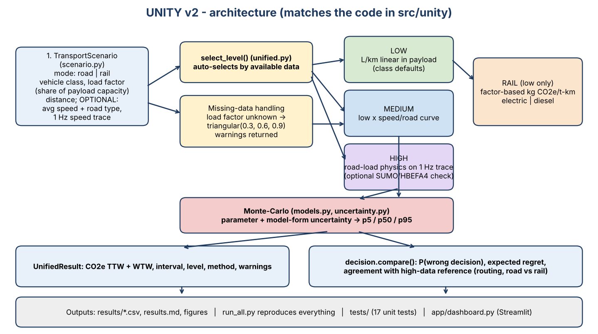

# UNITY v2 - Unified transport-emission estimates *with* accuracy assessment

Research prototype for the KLU PhD project *"UNITY: A Unified Model for Estimating Transport Emissions and
Assessing Their Accuracy"* (Kühne Logistics University / Kuehne Climate Center).

**One-sentence summary:** one interface estimates freight-transport CO2e from whatever data are available
(low / medium / high), returns an *uncertainty interval* instead of a single number, and shows when the
**level of data changes a decision**.



## 1. What it does (three project parts -> prototype)

| UNITY part | In this prototype |
|---|---|
| 1. Compare estimation methods on benchmark scenarios | Three road methods (factor-based, speed/road-curve, trajectory physics) + optional SUMO/HBEFA4 cross-check; 4 reference scenarios with controlled, seeded trajectories (`data/scenarios/`) |
| 2. Unified model that adapts to data and reports accuracy | `unity.estimate()` picks the method **automatically** from the available fields, returns TTW and WTW CO2e with p5/p50/p95, the method used, and warnings; rail added as a second mode |
| 3. Effect of accuracy on decisions | `unity.compare()`: probability of a wrong decision, expected regret, and agreement with the high-data reference, applied to a routing decision and to road vs rail |

## 2. Quick start

```bash
pip install -r requirements.txt
python run_all.py                       # reproduces every number/table/figure in results/
python -m unittest discover -s tests    # 17 tests
streamlit run app/dashboard.py          # interactive demo
```

```python
from unity import Vehicle, Trip, TransportScenario, estimate
from unity.trajectory import build_trajectory

trace = build_trajectory(100, 80, "motorway", seed=1)            # 1 Hz, controlled mean speed
scn = TransportScenario("demo", "road", Vehicle("rigid_truck", load_factor=0.6),
                        Trip(100, road_type="motorway", speed_trace_kmh=trace))
r = estimate(scn)                          # level chosen automatically -> "high"
print(r.level, r.point_wtw_kg, r.wtw)      # point estimate and {p5, p50, p95, ...}
```

## 3. Results (generated by `run_all.py`; full tables in `results/results.md`)

> **All vehicle, fuel-chain and uncertainty parameters are placeholder assumptions** (`src/unity/params.py`).
> The numbers show that the *framework* works; they are not validated findings.

**Estimates, scenario S1 (rigid 30 t, 60 % load, 100 km, motorway 80 km/h), kg CO2e per trip (WTW):**

| level | point | 5-95 % interval | relative half-width |
|---|---|---|---|
| low | 102.3 | 72.0 - 148.9 | 0.37 |
| medium | 112.7 | 81.9 - 155.4 | 0.33 |
| high | 101.9 | 86.1 - 123.0 | 0.18 |

Averaged over the four scenarios the relative half-width is 0.37 (low), 0.33 (medium), 0.17 (high). This
ordering is a *consequence of the assumed input uncertainties*; calibrating them against reference data
is the core research task.

**Routing decision** (same truck, route A = 100 km motorway at 80 km/h, route B = rural at 55 km/h, B's
length varies; `results/figures/routing_decision.png`):

* With B = 90 km the low- and medium-data estimates say B is 10 % / 24 % better; the high-data model says
  only 0.8 % better, and inside that level the probability that B is truly worse is about 33 %.
* Using the high-data model as reference, the nominal break-even length of B is about 91 km. For B between
  92.5 km and 100 km the low- and medium-data levels still choose B, although the high-data estimate prefers
  A; the regret of following them is up to 6.8 % (low) and 9.4 % (medium) of the best option's emissions.
* Lesson: parameter uncertainty alone (`p_wrong`) under-states decision risk; **model-level error between
  data levels** matters and is exactly what UNITY should quantify. (The high-data model is itself a
  placeholder here and is used as a reference for demonstration only.)

## 4. Method summary

| level | needs | method |
|---|---|---|
| low | vehicle class, distance (+ load factor) | consumption (L/km) linear in **payload** (= payload capacity x load factor) |
| medium | + average speed, road type | low-data consumption x speed/road-type curve (illustrative) |
| high | + 1 Hz speed trace | road-load physics per second (rolling, aerodynamic, inertial), optional HBEFA4 via SUMO |
| rail | distance, tonnes, traction | factor-based kg CO2e per t-km (diesel or electric) |

Reporting boundary: CO2e, **TTW and WTW** (WTW = TTW + well-to-tank). Uncertainty: Monte-Carlo (default 3000
draws, fixed seed) over load factor, consumption, physics parameters, emission factors.

## 5. Limitations (honest list)

* Parameters are placeholders; no validation against measured data yet. Replacing them with cited values
  (GLEC Framework defaults, HBEFA/COPERT, measurements) and validating is the first research step.
* The medium-data speed curve is illustrative, not taken from a published model.
* Trajectories are synthetic. Heavy trucks only (rigid, articulated; diesel; Euro VI assumed).
* Rail has only a factor-based method; no first/last-mile or terminal handling. No other modes yet.
* ISO 14083 / GLEC are respected in spirit (explicit boundary, WTW/TTW, CO2e) but the prototype is not a
  certified accounting tool.
* The SUMO/HBEFA4 backend could not be executed while preparing v2 (SUMO unavailable); it is covered
  only by a parser test on the legacy v1 result file. HBEFA licence terms apply to HBEFA-derived data.
* The Streamlit dashboard was syntax-checked but not launched while preparing v2 (Streamlit unavailable).

## 6. Repository layout

```
src/unity/      scenario, trajectory, models, uncertainty, unified, decision, sumo_backend, params
app/            Streamlit dashboard
tests/          17 unit tests (unittest)
data/scenarios/ reference scenarios (JSON);  data/legacy_sumo/  v1 SUMO files with explanation
results/        generated by run_all.py (tables, figures, results.md)
docs/           architecture diagram;  REVIEW_FIXES.md  what changed from v1 and why
```

## 7. Roadmap (PhD)

1. Literature review and implementation of established models (COPERT, HBEFA, GLEC/ISO 14083 default-based
   methods) on shared benchmark scenarios; replace placeholders with cited parameters.
2. Validation/calibration against measured fuel or emission data; data-level-specific error models.
3. More modes (rail, inland waterway, sea, air) and the emerging-economy data-scarcity case.
4. Embed the uncertainty in planning and optimisation problems (mode choice, routing, fleet) with
   operations-research solvers; study robust decisions under emission-estimate uncertainty.

*Author: Mohsen Ebadollahi Kalkhoran.*
